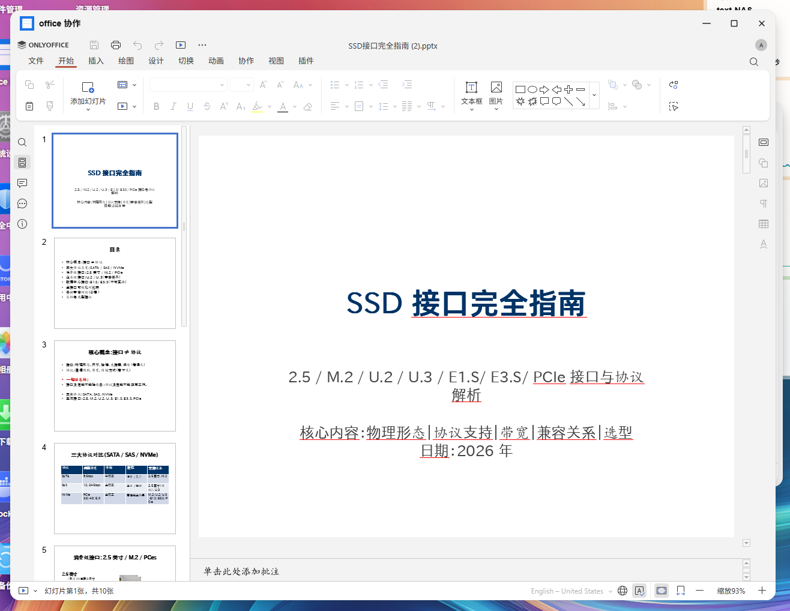

# office Collaboration — FNos Office Online Editor

A native Office online collaborative editor for FNos. Based on [OnlyOffice](https://www.onlyoffice.com/), it supports online editing of Word/Excel/PPT, real-time multi-user collaboration, user identity recognition, and custom fonts.

---

## Features

| Feature | Description |
|------|------|
| 📝 **Online Editing** | Edit DOCX/XLSX/PPTX directly in the browser |
| 👁️ **Document Preview** | Online viewing of PDF/TXT/CSV and other formats |
| 👥 **User Recognition** | Displays real FNos usernames during comments and collaborative editing |
| 🆕 **Create New** | Create blank Word/Excel/PPT documents with one click |
| 📂 **History** | Automatically records recently opened files for quick access |
| 🔤 **Custom Fonts** | Set a font directory for automatic loading into OnlyOffice |
| 🔒 **Admin Control** | Only FNos administrators can modify font settings |
| 🔄 **Auto Reconnect** | Automatically restores connection after switching browser tabs |
| 🧹 **Clean Uninstall** | One-click removal of Docker containers, volumes, and configurations |

---

## Interface Preview




---

## Download & Installation

### Method 1: Manual Installation via App Center (Recommended)

1. Download `OfficeEditor.fpk` from [Releases](https://github.com/a10463981/fnos-office-editor/releases).
2. FNos → App Center → Manual Install → Select the fpk file.
3. Wait for installation to complete (approx. 1 minute, including pulling the OnlyOffice image).
4. Refresh the FNos File Manager page.
5. Right-click an Office file → **"office collaboration"** to start editing.

### Method 2: Developer Build

```bash
git clone https://github.com/a10463981/fnos-office-editor.git
cd fnos-office-editor
# Requires Go 1.22+ and fnpack
cd connector && go build -o ../app/connector/officeeditor-connector ./cmd/server/
cd .. && fnpack build --directory .
```

---

## Architecture

```
FNos Browser (5666)
    │
    ├─ /cgi/ThirdParty/OfficeEditor/index.cgi (CGI Proxy)
    │       │
    │       ├─ ?path=xxx → curl → Connector (10088) → Editor Page
    │       └─ No params → curl → Connector (10088) → Home (New+History+Settings)
    │
    └─ /officeeditor/ → nginx proxy → Connector (10088)

Connector (Go, systemd service, Port 10088)
    │
    ├─ /api/create  → Create blank doc (docx/xlsx auto-generated, pptx embedded OnlyOffice template)
    ├─ /api/history → Recently opened records
    ├─ /api/config  → Font directory config (Automatic Docker restart + fc-cache after save)
    ├─ /api/version → Version information
    └─ /editor      → OnlyOffice editor page

OnlyOffice Document Server (Docker, Port 9080)
    │
    ├─ onlyoffice/documentserver:latest
    ├─ /usr/share/fonts/custom ← User custom fonts
    └─ JWT Secure Communication
```

---

## Configuration

### Custom Fonts

1. Create a font directory in FNos File Manager (e.g., `/vol1/1000/MyFonts/`).
2. Place `.ttf` or `.otf` files into that directory.
3. Open the Office Collaboration home page → Click the **⚙️** icon in the top right → Enter the font directory path → Save.
4. The Docker container will automatically restart and rebuild the font cache (approx. 20 seconds).

### Manual Configuration

```bash
# View current configuration
curl http://<fnos-ip>:10088/api/config

# Set font directory
curl -X POST http://<fnos-ip>:10088/api/config \
  -H "Content-Type: application/json" \
  -d '{"fontsDir":"/vol1/1000/MyFonts"}'
```

---

## Environment Variables

| Variable | Default Value | Description |
|------|--------|------|
| `JWT_SECRET` | Auto-generated during install | JWT communication key |
| `BASE_URL` | `http://localhost:10088` | Connector address |
| `FONTS_DIR` | `/vol1/1000/fonts` | Custom font directory |
| `TRIM_PKGVAR` | `/var/apps/OfficeEditor/var` | Data directory |

---

## Development

```bash
# Clone project
git clone https://github.com/a10463981/fnos-office-editor.git
cd fnos-office-editor

# Build connector
cd connector
go build -o /usr/local/bin/officeeditor-connector ./cmd/server/

# Start OnlyOffice
cd app/officeeditor-docker
docker compose up -d

# Start connector
JWT_SECRET=your-secret officeeditor-connector --port 10088

# Build FPK
fnpack build --directory .
```

---

## Project Structure

```
├── manifest              # FPK metadata
├── app/
│   ├── ui/config         # Desktop entry + file type associations
│   ├── ui/index.cgi      # CGI Proxy (Python)
│   ├── www/index.html    # Home page
│   ├── connector/        # Go binary
│   └── officeeditor-docker/
│       └── docker-compose.yaml
├── connector/
│   ├── cmd/server/       # Entry point
│   └── internal/server/  # Core logic
│       ├── server.go     # HTTP routing + Editor
│       ├── embed.go      # Embedded PPTX templates
│       └── templates/    # Template files
├── config/
│   ├── privilege         # Execution permissions
│   └── resource          # Docker resource declaration
├── cmd/                  # Lifecycle scripts
│   ├── install_callback  # Post-install configuration
│   ├── uninstall_callback # Complete cleanup
│   └── main              # start/stop/status
└── releases/             # Built FPKs
```

---

---

## 💰 Sponsorship

Your sponsorship is the motivation for my updates 💪


> After sponsoring, please leave your GitHub ID in the comments, and I will add you to the acknowledgments list 🙏

---

## License

[MIT License](LICENSE)

---

## Acknowledgments

- [OnlyOffice](https://www.onlyoffice.com/) — Open-source online document editor
- [onlyoffice-fnos](https://github.com/tf4fun/onlyoffice-fnos) — Original source of inspiration
- [fnnas fnOS](https://www.fnnas.com/) — NAS Operating System platform
